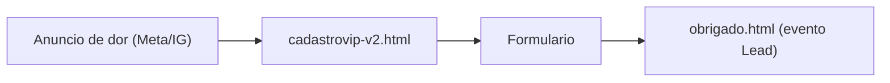

# Briefing de Criativos + Copy — Campanha de Captação

Atualizado em **17/10/2026** para o momento atual do app e da **LP v2** (dor primeiro, funcionalidade como prova).

Objetivo: captar os **50 casais fundadores**, levando tráfego pago (Meta/Instagram) para a landing **`cadastrovip-v2.html`**, com conversão medida na `obrigado.html` (Pixel `Lead` / GA4 `generate_lead`). A v1 (`cadastrovip.html`) permanece no ar só para A/B; **criativo novo aponta para a v2**.

Foco desta rodada: **casais** (verba paga 100% em casais). Público de borda (ficantes) só no orgânico.

---

## 1. Visão geral da campanha

- **Produto (hoje):** Nosso Momento não é só catálogo gamificado. É o app que tira o casal do modo automático: combinado com data, os dois puxam, agenda e gastos a dois. Foguinhos continuam sendo a moeda.
- **Promessa central (hero da LP v2):** "Vocês se amam. Só que a rotina tá ganhando."
- **Sub:** "A gente marca e nunca faz. A noite vira série de novo. Não é falta de amor, é o modo automático."
- **Mecanismos que a LP usa como prova (nesta ordem):**
  1. Catálogo privado + resgate com foguinhos
  2. **Prazo do momento** (1 a 30 dias; combinado visível)
  3. **Desafios semanais + Disputa de Casais** (Pontos de Conexão)
  4. **Calendário do casal**
  5. **Finanças a dois**
- **O que NÃO liderar no anúncio frio:** foguinhos, ranking, pódio, “economia inteligente”. Isso entra depois que a pessoa se reconheceu na dor.
- **Plataforma:** Meta Ads (Instagram + Facebook), Stories/Reels e Feed.
- **Objetivo:** Conversão (Lead) — evento `Lead` na `obrigado.html`.
- **Escassez/oferta:** 50 casais fundadores · acesso antecipado **100% gratuito**.
- **Público principal:** casais 18–45, relação estabelecida / morando juntos / rotina desgastada. Viés de entrega feminino (ela costuma ser a organizadora afetiva e quem compartilha).
- **Match anúncio → LP:** o criativo deve repetir uma frase do espelho da v2. Se o anúncio for “catálogo de foguinhos” e a LP for dor, o lift some.



### Estrutura da mídia (3 camadas)

| Camada | Papel | Criativo | Destino |
|---|---|---|---|
| Topo | Parar o scroll | Dor / espelho (V1, V2, C1) | v2 `#espelho` ou `#form` |
| Meio | Entender o “como” | Prazo, os dois puxam, carrossel | v2 `#como-funciona` |
| Fundo | Converter | Oferta 50 vagas + CTA | v2 `#form` |

Retargeting: quem viu o vídeo de dor mas não converteu → carrossel “como funciona” ou estático de prazo.

---

## 2. Diretrizes visuais globais

- **Fundo:** dark (`#0a0a0a` / `#050505`). Nada de fundo claro.
- **Glow da marca:** vermelho/rosa → laranja. Aura, não bloco chapado.
- **Cor de destaque:** gradiente `rose-500 → orange-500`.
- **Logo:** `logo-topdown-white-txt.png` sobre fundo escuro.
- **Símbolo:** foguinho só como detalhe de marca, **não** como headline do anúncio frio.
- **Tom:** intimista, quente, fala COM o casal (“vocês”). Nunca clínico, nunca dating.
- **Tipografia on-image:** Inter bold, no máximo 6–8 palavras.
- **Formatos:**
  - 9:16 (1080×1920) — Stories/Reels (prioridade dos comerciais Flow)
  - 4:5 (1080×1350) — Feed
  - 1:1 (1080×1080) — carrossel
- **Safe zones Stories:** ~250 px no topo e na base livres.
- **Prints reais (mockup de celular, proporção iPhone 11 828×1792):**
  - `assets/prints/Fundoheader.png` — dashboard (hero de trás)
  - `assets/prints/tela-login.png` — login (hero da frente)
  - `assets/prints/tela-catalogo.jpeg` — catálogo
  - `assets/prints/tela-prazo.jpg` — resgate com prazo
  - `assets/prints/tela-ranking.jpg` — desafio da semana (pódio ainda não existe)
  - `assets/prints/tela-calendario.jpg` — calendário do casal
  - `assets/prints/tela-financas.jpg` — finanças a dois
  - `assets/prints/tela-carrinho.jpeg` — carrinho
  - `assets/prints/tela-parceiro.jpeg` — parceiro / foguinhos
- **Selo de escassez:** pill `Restam poucas vagas · 100% gratuito` (borda vermelha, fundo translúcido).
- **Vídeo gerado (Flow):** sem texto, logo ou UI do Instagram no take. Tipografia e CTA entram no CapCut/Premiere.

---

## 3. Guia de copy

- **CTA:** "Quero nossa vaga" (alt: "Garantir nossa vaga de fundadores").
- **Sempre:** gratuidade + 50 casais fundadores.
- **Vocabulário da v2 (usar no anúncio):**
  - "A gente marca e nunca faz."
  - "Sempre sou eu que puxo o encontro."
  - "A noite vira série no sofá de novo."
  - "Não é falta de amor, é o automático."
  - "Combinado que sai do papel."
- **Evitar no frio:** match, crush, date, foguinhos como palavra de abertura, “gamificar”, pódio, ranking.
- **Regra:** headline on-image curta; corpo no texto do anúncio.

---

## 4. Os 5 criativos pagos (estáticos) — casais

Onde há 2 headlines, é A/B do mesmo conceito.

### C1 — Feminino · Dor da rotina (prioridade nº 1)

- **Público:** mulheres em relação estabelecida / morando junto.
- **Objetivo:** parar o scroll por identificação.
- **Visual:** casal no sofá à noite, cada um no celular. Dark + glow vermelho frio.
- **Headline:**
  - A) "A gente marca e nunca faz."
  - B) "Vocês se amam. A rotina tá ganhando."
- **Apoio:** "Não é falta de amor. É o automático."
- **Texto primário:** "A noite vira série de novo. Sempre a mesma pessoa puxa o encontro. O Nosso Momento transforma o 'um dia a gente faz' em combinado com data — os dois veem, os dois puxam. Acesso antecipado gratuito para os 50 primeiros casais fundadores."
- **Título:** "Saiam do modo automático"
- **Descrição:** "Acesso antecipado gratuito · 50 casais fundadores"
- **CTA:** "Quero nossa vaga"
- **Formato:** 9:16 + 4:5. Destino: `cadastrovip-v2.html#form`
- **Vídeo:** comercial **V1** (prompts Flow abaixo).

### C2 — Feminino · Combinado com prazo (mecânica, sem jargão)

- **Público:** quem já sentiu a dor e quer o “como”.
- **Objetivo:** prova de produto sem falar foguinho na headline.
- **Visual:** mockup `tela-prazo.jpg` + `tela-calendario.jpg` em moldura de iPhone.
- **Headline:**
  - A) "O combinado não morre no WhatsApp."
  - B) "Marca com data. Os dois veem."
- **Apoio:** "1, 3, 7, 14 ou 30 dias para viver de verdade."
- **Texto primário:** "Vocês resgatam o momento, escolhem o prazo e ele aparece no calendário do casal. Sem promessa que some na conversa. Acesso antecipado gratuito para os 50 casais fundadores."
- **Título:** "Um combinado que sai do papel"
- **Formato:** 4:5 + 9:16. Destino: `cadastrovip-v2.html#como-funciona`
- **Vídeo:** comercial **V3**.

### C3 — Feminino · Resultado (quinta-feira)

- **Público:** ângulo emocional.
- **Objetivo:** desejo do depois.
- **Visual:** casal fora de casa, luz quente, sexta/quinta à noite. Sem celular na mão.
- **Headline:**
  - A) "Voltamos a sair às quintas."
  - B) "Menos série no sofá. Mais vocês."
- **Texto primário:** "Não porque alguém cobrou: estava marcado, com data, e os dois viam. O Nosso Momento tira vocês do automático e devolve o encontro. 50 vagas de casal fundador, acesso gratuito."
- **Título:** "O que muda no dia a dia"
- **Formato:** 9:16 + 4:5.
- **Vídeo:** comercial **V5**.

### C4 — Carrossel · Como funciona (educativo / retarget)

- **5 cards 1:1 ou 4:5**, mesma moldura.
  1. Gancho: "Isso acontece com vocês?" → "A gente marca e nunca faz."
  2. "1. Os desejos saem da cabeça" — `tela-catalogo.jpeg`
  3. "2. O combinado ganha prazo" — `tela-prazo.jpg`
  4. "3. Os dois puxam" — `tela-ranking.jpg` (desafio da semana)
  5. CTA: "Entrem grátis na lista dos 50." Botão "Quero nossa vaga"
- **Texto primário:** "Como o Nosso Momento tira vocês do automático: o desejo vira combinado, o combinado ganha data, os dois puxam. Calendário e finanças a dois vêm junto. Acesso antecipado gratuito para 50 casais fundadores."
- **Título:** "Veja como funciona"

### C5 — Masculino · Sem quebrar a cabeça

- **Público:** homens que querem surpreender e travam.
- **Headline:**
  - A) "Surpreenda ela sem quebrar a cabeça."
  - B) "O encontro já está no catálogo. É só viver."
- **Texto primário:** "Sem saber o que fazer no fim de semana? Ela já colocou no catálogo. Você resgata, escolhe o prazo, aparece no calendário. Acesso antecipado gratuito para os 50 casais fundadores."
- **Não usar** “é só resgatar foguinho” como abertura.
- **Vídeo:** comercial **V6**.

---

## 5. Conteúdo orgânico — borda (ficantes)

Sem verba. Topo de funil:

- Reel "Da ficada ao próximo nível" — humor, CTA “marca aquele alguém”.
- POV “casal no automático vs. casal com combinado”.
- Carrossel “sinais de que a rotina tá ganhando” (frases do espelho da LP).

---

## 6. Boas práticas Meta

- Duas primeiras linhas do texto primário = gancho de dor + oferta.
- Pouco texto na imagem.
- Testar A/B de headline; o criativo de **dor (C1/V1)** é o cavalo de batalha.
- Todo estático: logo branca + badge + CTA padronizado.
- Destino padrão: `https://nossomomento.app/cadastrovip-v2.html#form`
- UTMs: `utm_source=meta&utm_medium=pago&utm_campaign=fundadores_v2&utm_content=c1_dor` (trocar `c1_dor` por criativo).
- A LP v2 grava `landing_url` e usa `data-lp-cta` com sufixo `_v2`.

---

## 7. Checklist de entrega

- [ ] 9:16, 4:5 (e 1:1 no carrossel)
- [ ] Headline A/B legível no mobile
- [ ] Logo branca + badge de vagas
- [ ] CTA "Quero nossa vaga"
- [ ] Prints sem corte de topo, proporção iPhone 11
- [ ] Vídeos Flow sem texto gerado; overlay no editor
- [ ] Destino v2 + UTM
- [ ] Safe zones Stories

---

## 8. Comerciais no Google Flow

Ferramenta: **Google Flow** (Veo). Cada take abaixo é **um prompt para colar**, ~8 s, **9:16**, fotorealista. Texto, logo e CTA **não** vão no Flow — entram no CapCut.

### 8.1 Como usar

1. Crie dois **Ingredients** (personagens) com os blocos ANA e PEDRO. Reuse em todos os takes.
2. Aspect ratio: **Portrait 9:16**.
3. Gere o take → se o rosto mudar, regenere com o mesmo Ingredient, não mude o texto do personagem.
4. Encadeie os takes no editor do Flow (Add to scene / extend) na ordem do comercial.
5. Exporte e abra no CapCut: overlay Inter, badge, CTA, logo, legendas.

Se o Flow responder melhor em inglês, cole o bloco **PROMPT (colar no Flow)**. A linha em português é só para você saber o que o take é.

### 8.2 Bíblia de consistência (colar no começo de TODO prompt)

Ingredient **ANA:**
`Brazilian woman, 29, warm olive skin, long dark wavy hair, gold small hoop earrings, oversized camel knit sweater, natural makeup, realistic pores, same face every shot`

Ingredient **PEDRO:**
`Brazilian man, 31, light brown skin, short dark curly hair, thin faded beard, heather-grey t-shirt, realistic pores, same face every shot`

Estilo mestre (já está repetido em cada prompt; não precisa colar à parte):
`photorealistic live-action, cinematic, 35mm, shallow depth of field, São Paulo apartment at night, no on-screen text, no logos, no subtitles, no UI, no watermarks`

### 8.3 Paleta e câmera (para todos)

- Interior: luz de TV fria + um spill vermelho/rosa bem baixo (marca).
- Exterior/resultado: tungsten quente, golden hour ou restaurante baixo.
- Câmera: movimento lento (push-in, handheld suave). Nada de whip pan, nada de CGI, nada de telefone flutuando sozinho.

---

### Comercial V1 — “A noite vira série de novo” (15–24 s)

Uso: C1, topo de funil. 3 takes.

**Take V1-A — Sofá, cada um no celular (8 s)**

PROMPT (colar no Flow):
```
Photorealistic cinematic vertical 9:16, 8 seconds. Brazilian woman ANA, 29, warm olive skin, long dark wavy hair, gold hoop earrings, camel knit sweater, and Brazilian man PEDRO, 31, light brown skin, short dark curly hair, thin faded beard, grey t-shirt, sit side by side on a dark charcoal sofa in a São Paulo living room at night. They do not touch. Each stares at their own phone. A muted TV throws cold blue light on their faces. A faint red neon leak from the window. Slow push-in from a medium-wide to a medium two-shot. Melancholic, quiet, real. No smiling. No on-screen text, no logos, no UI.
```

**Take V1-B — Close nos dois celulares (8 s)**

PROMPT:
```
Photorealistic cinematic vertical 9:16, 8 seconds. Over-the-shoulder of ANA's and PEDRO's hands, same couple as before, two phones glowing in a dark living room. Screens show generic social feeds, not a readable brand. Their knees almost touch but bodies lean away. Slow lateral drift. Shallow depth of field, 35mm. Cold TV light, faint rose spill. Intimate and sad. No on-screen text, no logos.
```

**Take V1-C — Olhar que não se encontra (8 s)**

PROMPT:
```
Photorealistic cinematic vertical 9:16, 8 seconds. Tight close-up: ANA looks up from her phone toward PEDRO for one second, he does not notice, she looks back down. Same faces, same clothes, same sofa, night. Almost no camera move, tiny handheld. A single soft red practical light in the background bokeh. Silence, real life. No on-screen text, no logos.
```

**Overlay CapCut (não gerar no Flow):**  
0–3 s: `A noite vira série de novo.`  
8–14 s: `Não é falta de amor.`  
16–22 s: `É o automático.`  
Final 2 s: logo + `50 vagas · 100% gratuito` + `Quero nossa vaga`

---

### Comercial V2 — Espelho (12–16 s)

Uso: reforço de C1, rumble de comentário (“fui eu”).

**Take V2-A — Ela que sempre puxa (8 s)**

PROMPT:
```
Photorealistic cinematic vertical 9:16, 8 seconds. ANA, 29, Brazilian, long dark wavy hair, camel sweater, stands in a dim kitchen doorway at night holding her phone, thumb hovering over a message that is not readable. She exhales, tired, looking toward the living room where PEDRO is a blur on the sofa with a phone. Slow push-in on her face. Warm under-cabinet light mixed with cool living-room TV glow. Real, not glamorous. No on-screen text, no logos.
```

**Take V2-B — Calendário vazio na parede (8 s)**

PROMPT:
```
Photorealistic cinematic vertical 9:16, 8 seconds. A paper wall calendar in a São Paulo apartment, evening, most days empty, one handwritten plan crossed out. Camera slowly racks from the calendar to the couple on the sofa in the background, each on a phone. Moody, dark, faint rose light. 35mm. No readable brand names. No on-screen text, no logos.
```

**Overlay CapCut:**  
`Sempre sou eu que puxo o encontro.` → `A gente marca e nunca faz.`

---

### Comercial V3 — Combinado com data (16–24 s)

Uso: C2, meio de funil. Mostra o app só no take final, print real no editor se o Flow inventar UI.

**Take V3-A — Ele mostra o telefone para ela (8 s)**

PROMPT:
```
Photorealistic cinematic vertical 9:16, 8 seconds. Same couple ANA and PEDRO on the sofa at night, but now they sit closer. PEDRO turns his phone toward ANA; both actually look at the same screen. Soft smile starting. Warmer practical lamp turns on beside them, killing some of the blue TV light. Slow push-in. Tender, not cheesy. Phone screen is slightly out of focus, no readable UI. No on-screen text, no logos.
```

**Take V3-B — Mãos escolhendo um prazo (8 s)**

PROMPT:
```
Photorealistic cinematic vertical 9:16, 8 seconds. Extreme close-up of ANA's and PEDRO's hands together over one phone in a dark room, thumb tapping once. Shallow depth of field, specular highlights, faint rose glow on the knuckles. Intimate, quiet. Do not render a readable app interface; keep the screen abstract light. No on-screen text, no logos.
```

**Take V3-C — Calendário na parede agora com um círculo (8 s)**

PROMPT:
```
Photorealistic cinematic vertical 9:16, 8 seconds. The same wall calendar, now a date circled in red pen, a small heart. Morning light, apartment in São Paulo. Camera tilts down from the calendar to two coffee mugs on the table. Hopeful, simple, real. No on-screen text, no logos.
```

**Overlay CapCut:**  
`O combinado não morre no WhatsApp.`  
`Vocês escolhem o prazo. Os dois veem.`  
Inserir corte de 1,5 s do print `tela-prazo.jpg` ou `tela-calendario.jpg` entre B e C se o Flow não entregar UI fiel.

---

### Comercial V4 — Os dois puxam (12–16 s)

Uso: desafio da semana. Não falar “ranking” nem “pódio”.

**Take V4-A — Os dois riem no sofá, um celular (8 s)**

PROMPT:
```
Photorealistic cinematic vertical 9:16, 8 seconds. ANA and PEDRO on the sofa, night, sharing one phone, both laughing at the same time, shoulders touching. Warm lamp, leftover blue TV. Handheld, alive. They look like a team. Phone screen out of focus. No on-screen text, no logos.
```

**Take V4-B — Ela começa a frase, ele completa no olhar (8 s)**

PROMPT:
```
Photorealistic cinematic vertical 9:16, 8 seconds. Medium shot, ANA starts to speak, PEDRO already nodding, they both tap the phone together. Same apartment, same clothes as previous shots. Playful, competitive in a kind way. Slow dolly left. Photorealistic. No on-screen text, no logos.
```

**Overlay CapCut:**  
`Os dois puxam, não só um.`  
Print opcional: `tela-ranking.jpg` (desafio Preferências).

---

### Comercial V5 — Voltamos a sair às quintas (16–24 s)

Uso: C3, fundo de funil emocional.

**Take V5-A — Porta do apê, saindo (8 s)**

PROMPT:
```
Photorealistic cinematic vertical 9:16, 8 seconds. Night, São Paulo apartment hallway. ANA in a simple black top, PEDRO in a shirt over the grey tee, they grab keys, she takes his hand, they leave. Warm tungsten. Camera follows from behind then they glance back at each other. Life, not a catalog shoot. No phones in hands. No on-screen text, no logos.
```

**Take V5-B — Mesa de bar/restaurante (8 s)**

PROMPT:
```
Photorealistic cinematic vertical 9:16, 8 seconds. Same couple at a small São Paulo restaurant table at night, one shared plate, they are talking and smiling, phones face-down. Practical candles, bokeh city lights through the window. Slow orbit, 35mm. Intimate, adult, real Brazil. No on-screen text, no logos.
```

**Take V5-C — Volta para casa, testa na testa (8 s)**

PROMPT:
```
Photorealistic cinematic vertical 9:16, 8 seconds. Same couple at the apartment door after the date, forehead to forehead, quiet laugh. Dim hallway, one warm bulb. Stillness. Photorealistic. No on-screen text, no logos.
```

**Overlay CapCut:**  
`Voltamos a sair às quintas.`  
`Não porque alguém cobrou. Estava marcado.`

---

### Comercial V6 — Masculino, sem quebrar a cabeça (12–16 s)

Uso: C5.

**Take V6-A — Ele travado no WhatsApp (8 s)**

PROMPT:
```
Photorealistic cinematic vertical 9:16, 8 seconds. PEDRO, 31, Brazilian, short dark curly hair, faded beard, grey t-shirt, sits on the sofa at night staring at a blank WhatsApp compose box, unsure. ANA is not in the shot. Frustrated but soft, not angry. Slow push-in. Dark living room, TV glow. No readable UI brands if possible. No on-screen text, no logos.
```

**Take V6-B — Ele sorri, decide, chama ela (8 s)**

PROMPT:
```
Photorealistic cinematic vertical 9:16, 8 seconds. Same PEDRO, now a small smile, he stands up, walks to the kitchen, finds ANA, shows the phone. She lights up. Warm lamp. Handheld follow. Relief, simple. Screen out of focus. No on-screen text, no logos.
```

**Overlay CapCut:**  
`Sem saber o que fazer no fim de semana?`  
`O encontro já está no catálogo.`

---

### 8.4 Ordem de produção no Flow (sugerida)

1. Ingredients ANA + PEDRO (gerar 4 stills, escolher 1 de cada e travar).
2. V1-A (é o teste de consistência). Se o rosto falhar, não siga.
3. V1-B, V1-C no mesmo projeto.
4. V3 e V5 no mesmo projeto (mesma roupa).
5. V4 e V6 por último (podem mudar o mood, não a cara).

**Não peça no Flow:** interface fiel do Nosso Momento, logo, foguinho 3D, ranking, texto em português na tela. UI real = print inserido no editor.

### 8.5 Áudio (depois do Flow)

- V1/V2: silêncio + um pad baixo, quase ruído de apto.
- V3/V4: um clique de notificação original (gravar) + piano mínimo.
- V5: música quente, sem letra no gancho (libera direito).
- VO opcional feminina, íntima, só se o overlay não bastar. Não narrar o app.

---

## 9. Fora de escopo deste doc

- Não gera o arquivo de vídeo final.
- Não configura o Gerenciador de Anúncios.
- Não substitui o A/B da LP v1 vs v2 (ver estudo de atratividade).
